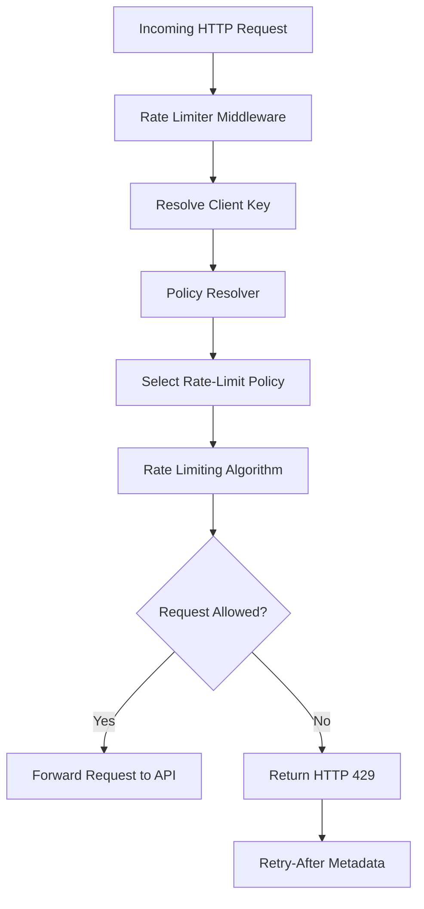
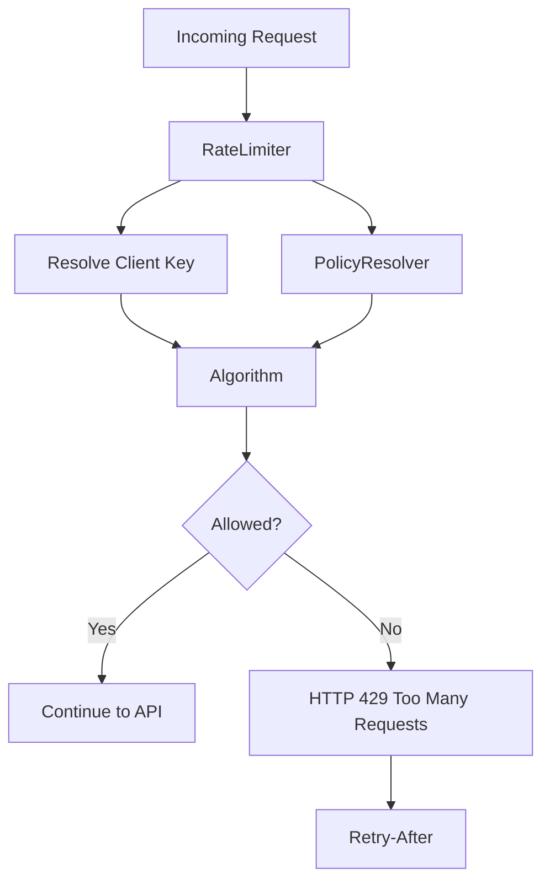
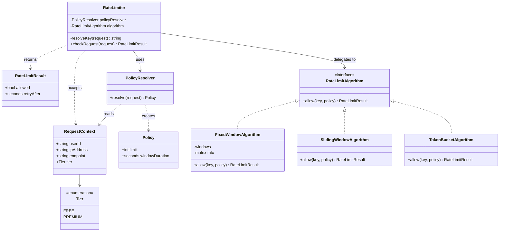
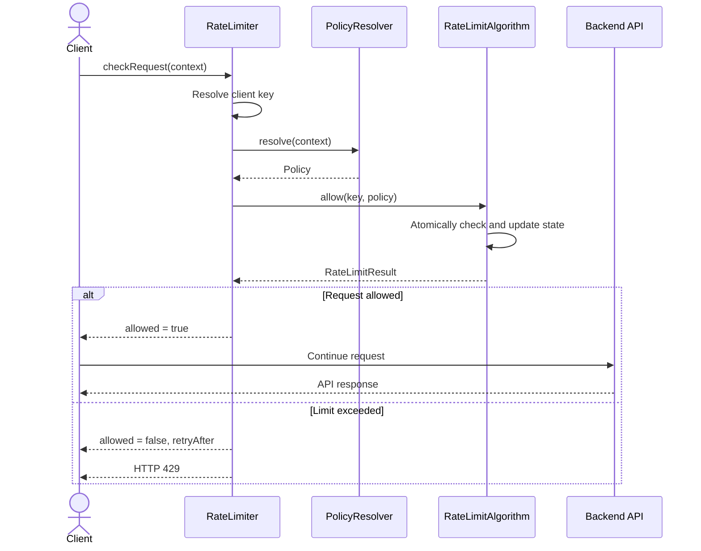
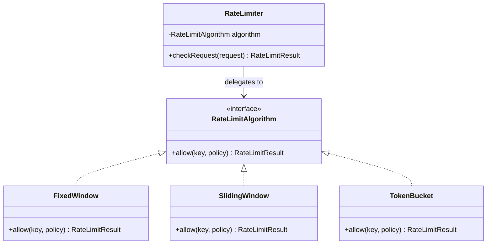

# 🚦 Rate Limiter — Low-Level Design

<p align="center">
  <strong>Designing a concurrent, extensible, and policy-driven rate limiting system</strong>
</p>

<p align="center">
  
  
  
</p>

---

## 📌 Table of Contents

- [1. Problem Statement](#-1-problem-statement)
- [2. Core Requirements](#-2-core-requirements)
- [3. High-Level Architecture](#-3-high-level-architecture)
- [4. Core Entities](#-4-core-entities)
- [5. Request Lifecycle](#-5-request-lifecycle)
- [6. Extensible Algorithm Design](#-6-extensible-algorithm-design)
- [7. Concurrency Considerations](#-7-concurrency-considerations)

---

## 🎯 1. Problem Statement

A **Rate Limiter** controls how many requests a client can make to a service within a specified time window.

It sits at the API entry point—either as application middleware or as an API gateway—and decides whether each incoming request should be allowed or rejected.

Without rate limiting, a single misbehaving client can consume excessive server resources, degrade performance, and affect the experience of other users.

**Example:** A free-tier user can make 10 requests per minute, while a premium user can make 100.

The goal is to build a rate limiter that is **configurable, thread-safe, and extensible**.

---

## 🧩 2. Core Requirements

| Requirement | Description |
|---|---|
| **Configurable Keys** | Identify clients using `userId`, IP address, API key, or another configurable key. |
| **Policy Management** | Support different limits based on user tier, endpoint, or other request attributes. |
| **Decision & Feedback** | Return whether a request is allowed and provide `retryAfter` when rejected. |
| **Concurrency Safety** | Correctly enforce limits when multiple requests for the same client arrive concurrently. |
| **Algorithm Extensibility** | Support Token Bucket, Fixed Window, and Sliding Window without changing caller code. |

### Example policies

| Client / Endpoint | Limit | Window |
|---|---:|---|
| Free user | 10 requests | 1 minute |
| Premium user | 100 requests | 1 minute |
| Login endpoint | 5 requests | 1 minute |

These are example policies; actual limits should be configurable.

---

## 🏗️ 3. High-Level Architecture

The rate limiter separates request identification, policy selection, and request-counting logic.



**Design principle:** The middleware coordinates the process, while the selected algorithm handles the actual rate-limit decision.

---

## 🧱 4. Core Entities

The entities below are derived directly from the requirements. Each has one clear responsibility.

### 4.1 `Policy`

Defines the rate limit itself.

```text
Policy
 ├── limit: int
 └── windowDuration: Duration
```

**Example:** `Policy(100, 60 seconds)` means at most 100 requests per minute under the selected algorithm's semantics.

A policy contains configuration only; it does not identify the client or implement the counting logic.

### 4.2 `Tier`

Classifies a user for policy selection.

```text
enum Tier {
    FREE,
    PREMIUM
}
```

A tier is useful when policies depend on subscription level. It is not mandatory if policies are selected using other attributes, such as endpoint or API key.

### 4.3 `RateLimitResult`

Represents the outcome of a request.

```text
RateLimitResult
 ├── allowed: boolean
 └── retryAfter: Duration? 
```

- `allowed = true`: continue processing the request.
- `allowed = false`: reject the request.
- `retryAfter`: indicates how long the client should wait before retrying.

For HTTP APIs, a rejected request commonly maps to `429 Too Many Requests`, with a `Retry-After` header when a meaningful retry duration can be calculated.

### 4.4 `RateLimitAlgorithm`

Defines the contract used by all rate-limiting strategies.

```text
RateLimitAlgorithm
 └── allow(key, policy) → RateLimitResult
```

Implementations can use different strategies without changing the calling code.

### 4.5 `RateLimiter`

The main entry point exposed to callers.

Its responsibilities are to:

1. Resolve the request's client key.
2. Select the applicable policy.
3. Delegate the decision to the configured algorithm.
4. Return a `RateLimitResult`.

**Key idea:** Callers interact with `RateLimiter`, not with individual algorithm implementations.

---
# 🚦 Rate Limiter — Low-Level Design in C++

<p align="center">
  <strong>A concurrent, policy-driven rate limiter using the Strategy Pattern</strong>
</p>

<p align="center">
  
  
  
</p>

## 1. Problem Statement

A rate limiter controls how many requests a client can make to a service within a specified time window. It protects APIs from excessive traffic and helps preserve server capacity for other clients.

**Example policies:**

| Client / Endpoint | Limit | Time Window |
|---|---:|---|
| Free user | 10 requests | 1 minute |
| Premium user | 100 requests | 1 minute |
| Login endpoint | 5 requests | 1 minute |

The goal is to implement a reusable rate limiter with configurable policies, concurrency safety, and interchangeable algorithms.

## 2. Requirements

- **Configurable client identification:** Identify clients using a user ID or IP address.
- **Policy-based limits:** Apply different limits based on subscription tier and endpoint.
- **Useful results:** Return an allow/reject decision and `retryAfter` metadata.
- **Concurrency safety:** Prevent concurrent requests from exceeding the limit in a single process.
- **Extensibility:** Support different rate-limiting algorithms through a common interface.

## 3. Architecture Overview



The `RateLimiter` coordinates the process. `PolicyResolver` chooses the applicable policy, while the algorithm enforces it.

## 4. UML Class Diagram



*Note: `SlidingWindowAlgorithm` and `TokenBucketAlgorithm` are future extension points in this implementation, not implemented classes in the current C++ file.*

## 5. Request Sequence Diagram



## 6. Design Patterns Used

### Strategy Pattern

`RateLimitAlgorithm` defines a common contract. Different algorithms can implement that contract without changing `RateLimiter`.

### Separation of Responsibilities

- `RateLimiter`: coordinates request processing.
- `PolicyResolver`: selects the applicable limit.
- `RateLimitAlgorithm`: makes the rate-limit decision.
- `RateLimitResult`: communicates the outcome.

## 7. Fixed Window Algorithm

Each client key maintains a request counter and the start time of its current window.

1. Initialize or reset the window when necessary.
2. Reject the request if the counter has reached the limit.
3. Otherwise, increment the counter and allow the request.
4. On rejection, calculate the remaining window duration.

**Time complexity:** Expected \(O(1)\) per request with a hash map.

**Space complexity:** \(O(K)\), where \(K\) is the number of distinct keys retained in the map.

## 8. Concurrency and Scalability

The implementation uses a mutex to protect the counter check and update as one critical section. This prevents two threads from simultaneously consuming the same remaining request allowance.

**Important limitation:** This is a single-process implementation. Multiple server instances would maintain independent counters. A distributed deployment would require shared state, such as Redis, with atomic operations or a Lua script.

A production implementation should also consider idle-key expiration, memory cleanup, policy changes, and trusted client identification.

## 9. Future Improvements

- Implement Sliding Window and Token Bucket.
- Add Redis-backed distributed rate limiting.
- Add per-user and per-endpoint policy configuration.
- Add unit tests for concurrency, window resets, and rejection behavior.
- Expose standard rate-limit response headers.

## 10. Run the Project

```bash
g++ -std=c++17 -pthread rate_limiter.cpp -o rate_limiter
./rate_limiter
```

---

**Key takeaway:** The design separates *which policy applies* from *how the limit is enforced*, making the system easier to test, extend, and evolve.


 
This sequence keeps HTTP-specific behavior in the middleware and rate-counting behavior inside the algorithm.

---

## 🔌 6. Extensible Algorithm Design

Use the **Strategy Pattern** to make the algorithm interchangeable.



### Supported strategies

| Algorithm | How it works | Main trade-off |
|---|---|---|
| **Fixed Window** | Counts requests within fixed time intervals. | Simple, but permits bursts around window boundaries. |
| **Sliding Window** | Tracks requests over a moving time interval. | Smoother enforcement, with potentially greater storage or computation costs. |
| **Token Bucket** | Refills tokens over time; each request consumes one. | Allows controlled bursts while limiting the sustained request rate. |

To switch strategies, configure a different `RateLimitAlgorithm` implementation. The middleware and calling code remain unchanged.

---

## 🔒 7. Concurrency Considerations

A correct rate limiter must handle simultaneous requests for the same key.

Consider a client with a limit of 10 requests and only one request remaining. If two requests concurrently read the count as 9, both might be allowed—exceeding the limit.

The operation that checks and updates the limit must therefore be **atomic**.

Possible approaches include:

- **Single-process implementation:** use an appropriate lock or atomic operation around the decision and state update.
- **Distributed implementation:** use an atomic Redis operation or Lua script to coordinate requests across application instances.
- **Algorithm-specific state:** protect token updates, window counters, and timestamps consistently.

A thread-safe local implementation alone is not sufficient when multiple server instances share the same logical rate limit.

---

## 💡 Key Takeaways

- Separate policy configuration from rate-limiting behavior.
- Keep the public API independent of the selected algorithm.
- Treat concurrency as a correctness requirement, not an optimization.
- Return useful rejection metadata to clients.
- Choose the algorithm based on the desired traffic behavior and operational constraints.

**Next step:** Implement the interfaces and data models, then build Fixed Window first as the simplest concrete strategy. Add Sliding Window and Token Bucket without changing the public `RateLimiter` API.
